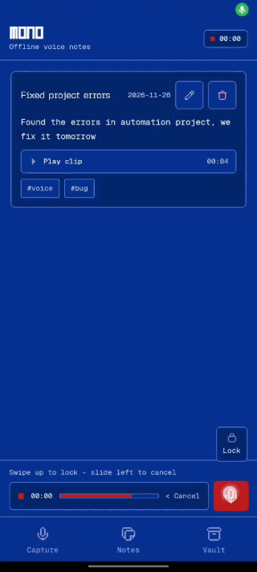

# mono

Offline Android voice notebook that records locally, transcribes speech with fine-tuned Whistle, and extracts a title, category tags, and checkable tasks into SQLite.

`v1.2.0` · `Android arm64-v8a` · `Expo SDK 52` · `Cactus 4.1.4`

<p align="center">
  
</p>

## Install

Download `mono-v1.2.0-arm64-v8a.apk` from [Releases](https://github.com/barryallen16/mono/releases), or build from source with Bun and EAS:

```bash
bun install
bun run build:preview
```

First launch downloads roughly 93 MB of SHA-256-verified model weights (`whistle.cact` 29.3 MB + `needle3.cact` 63.4 MB) from Hugging Face. After that, capture, transcription, extraction, playback, and search work offline with zero accounts or telemetry.

## How it works

```text
Hold mic / swipe up to lock
  -> MediaRecorder (.m4a clip in local storage)
  -> AudioDecoder.kt (MediaExtractor + MediaCodec + sinc resample to 16 kHz mono PCM)
  -> Whistle (whistle.cact via libcactus.a JNI -> chunked transcript)
  -> Needle 3 (needle3.cact save_note JSON tool call -> boolean flags + action_items)
  -> expo-sqlite (note card + playable clip + Tasks toggle checklist)
```

- **Hold-to-record capture:** Hold the mic button in the bottom bar to record up to 120 seconds, swipe up to lock hands-free, slide left to discard, or type a note directly.
- **On-device speech (Whistle):** Kotlin `MediaCodec` resamples recordings to 16 kHz mono PCM with Hann-windowed sinc interpolation, then Svarah-tuned `whistle.cact` transcribes 30-second windows with 1.5-second overlap, 6-word boundary deduplication, and custom Vault keywords.
- **Local extraction (Needle 3):** Fine-tuned `needle3.cact` (W4A8) invokes `save_note` over C++ JNI to output a headline, boolean category flags (`#bug`, `#ship`, `#idea`, `#people`, `#study`), pending tasks (`#todo`), or `#log` when uncategorized.
- **SQLite vault:** Notes and `.m4a` clips stay in `expo-sqlite` and app storage with `android:allowBackup="false"`. Switch between Notes and Tasks views, filter by keyword or `#tag` / `#open`, track the 14-day cadence grid, and export JSON via Storage Access Framework.

## Benchmarks

**Whistle Svarah WER (lower is better)**

Evaluated on `barryallen16/whistle-svarah` (`29,346,671` bytes, 4-bit `.cact`) against base `whistle`:

| Benchmark | Base Whistle | Fine-tuned |
|---|---|---|
| 100-clip runtime `.cact` (overall) | 19.21% | 14.71% |
| 100-clip runtime `.cact` (Tamil subset) | 20.69% | 16.75% |
| 1,047-clip Svarah held-out (greedy) | 20.58% | 17.2% |

**Needle 3 on 30 held-out voice notes**

Evaluated on `barryallen16/needle3-notes` against base `needle3`:

| Metric | Base Needle 3 | Fine-tuned |
|---|---|---|
| Tool call rate | 0.9333 | 1.0000 |
| Tag exact match | 0.1000 | 0.6333 |
| Tag F1 | 0.3261 | 0.7872 |
| Task exact match | 0.2000 | 0.9333 |
| Task F1 | 0.1778 | 0.9444 |
| Non-task false positive rate | 0.7222 | 0.1111 |

## Works with and known limits

**Works with**

- 64-bit Android (`arm64-v8a`) devices running local Whistle transcription and Needle 3 extraction via `libcactus.a`.
- One-time Hugging Face model caching into `filesDir/cactus` with SHA-256 verification.
- Offline capture, audio playback, task toggling, Vault keyword boosting, cache reset, and SAF JSON export.

**Known limits**

- First-time model setup downloads roughly 93 MB over the network before offline extraction starts; notes recorded while models are missing queue as raw transcripts.
- Merging the local LoRA drops Needle 3's confidence head, so `confidence` reports `null` and 11.1% non-task false positives remain on held-out notes.
- The release APK targets 64-bit `arm64-v8a` Android (`bun run build:prod` builds both `arm64-v8a` and `armeabi-v7a`); recordings cap at 120 seconds per clip.

## Repo layout

| Path | Purpose |
|---|---|
| `app/(tabs)/index.tsx` | Capture screen with latest note card, error links, and bottom composer |
| `app/(tabs)/notes.tsx` | Notes and Tasks toggle, debounced search, tag filters, inline note editor |
| `app/(tabs)/vault.tsx` | 14-day cadence grid, model download controls, JSON export, and data wipe |
| `app/onboarding.tsx` | First-launch onboarding flow and initial model download |
| `components/capture-composer.tsx` | Hold-to-record, swipe-up-to-lock, and slide-left-to-cancel composer bar |
| `modules/cactus-native/` | C++ JNI wrapper, `AudioDecoder.kt`, model downloader, and prebuilt `libcactus.a` |
| `plugins/with-expo-audio-fix.js` | Expo config plugin patching `expo-audio` Android recording, `file://` playback, and `allowBackup="false"` |
| `utils/` | SQLite schema, `expo-audio` playback and export helpers, and Cactus note pipeline |

## Checks

```bash
bun test
bun run lint
npx tsc --noEmit
```

Open an issue with your device model, Android version, and logcat output if Whistle or Needle 3 fails on a clip.
